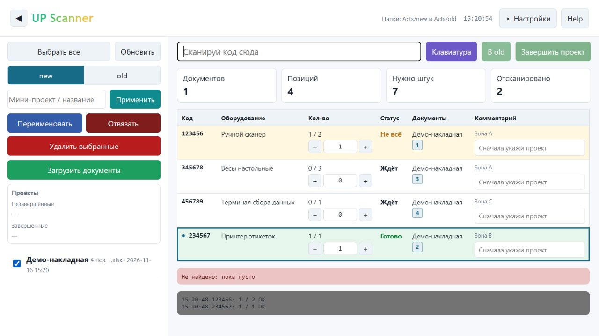
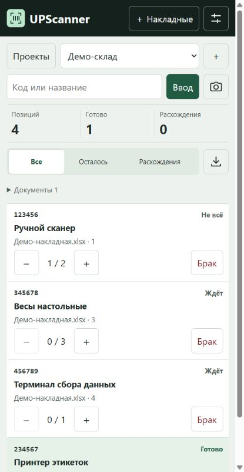

# UPScanner

**Сверка оборудования по накладным и актам.** Загрузите документы, отсканируйте коды и сразу увидите, что собрано, чего не хватает и где есть расхождения.

[Скачать Windows](https://github.com/jeronimo701/UPScanner/releases/download/release-2026-11-16/UPScanner-Setup-2026-11-16.exe) · [Скачать Android 1.3](https://github.com/jeronimo701/UPScanner/releases/download/release-2026-11-16/UPScanner-Android-1.3.apk) · [Что входит в выпуск](https://github.com/jeronimo701/UPScanner/releases/tag/release-2026-11-16)

## Возможности

| | Windows x64 | Android 7.0+ |
|---|---|---|
| Импорт | PDF с текстом, XLS, XLSX, XLSM | PDF с текстом, XLS, XLSX; импорт из меню «Поделиться» |
| Ввод кодов | Вручную, HID-сканер, VCOM/COM | Вручную, камера телефона, HID-сканер |
| Сверка | Факт и план, лишние коды, комментарии, мини-проекты и архив | Факт и план, брак, лишнее, отсутствующие коды и архив проектов |
| Экспорт | HTML для печати, PDF через Edge или Chrome | CSV для Excel |

Обе версии хранят данные локально. Android работает без Windows-сервера и аккаунта; проекты между платформами не синхронизируются. В PDF из фотографий и сканов нужен текстовый слой: OCR не входит в приложение.

## Скриншоты

**Windows: импортированная накладная и ход сверки.**

**Android: позиции проекта и фильтры расхождений.** На снимке — браузерный предпросмотр мобильного интерфейса.

На обоих снимках использована вымышленная накладная.

## Быстрый старт

1. **Windows:** запустите файл Setup, выберите папку с правом записи и откройте UPScanner.exe. Программа откроется в браузере. Импортируйте накладные через интерфейс или положите их в Acts/new. При переносе копируйте всю папку UPScanner; сохраняйте Acts и data.
2. **Android:** откройте APK на телефоне. Создайте проект, добавьте файлы через «Накладные» и начните сверку. Для сканирования камерой потребуется разрешение. При обновлении устанавливайте APK поверх предыдущей версии с той же подписью; удаление приложения стирает локальные проекты.
3. **Сверка:** сканируйте код или введите его вручную. Проверьте фактическое количество и расхождения, затем экспортируйте результат или отправьте завершённый проект в архив.

[Инструкция Windows](README_FOR_USER_Jeronimo701.md) · [Профили разбора документов](PARSER_PROFILE_GUIDE.md) · [Инструкция и сборка Android](android/README.md)

Исходники Windows запускаются командой `python main.py` после установки зависимостей из requirements.txt. Android-проект находится в android/. Авторские материалы: [лицензия для личного использования](LICENSE.txt). [Сторонние компоненты](THIRD-PARTY.md) сохраняют свои лицензии.
